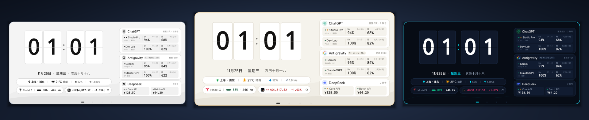
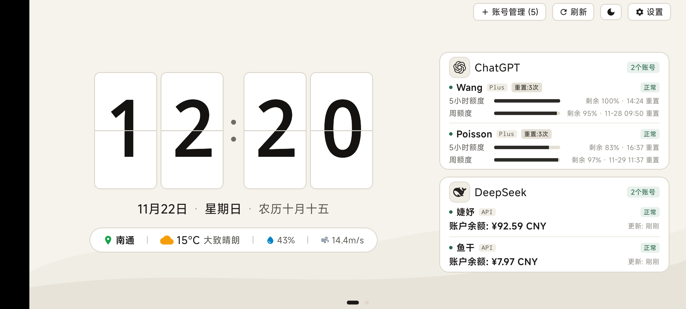
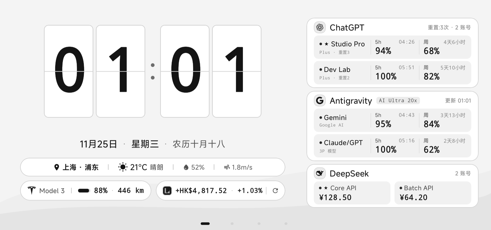
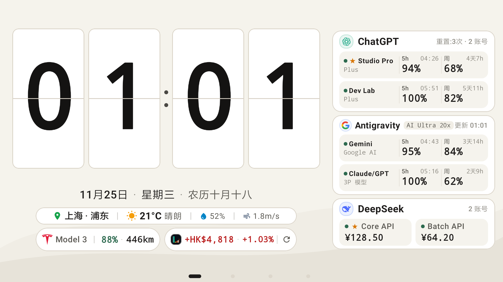
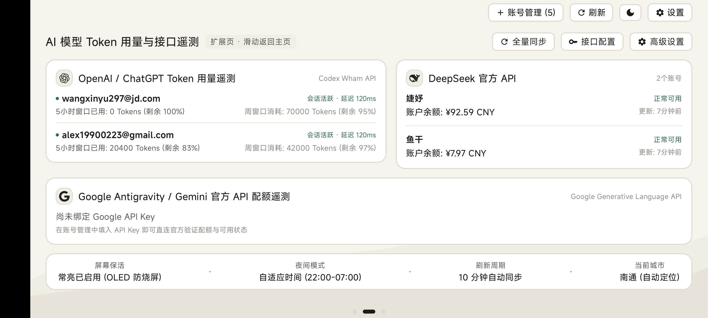
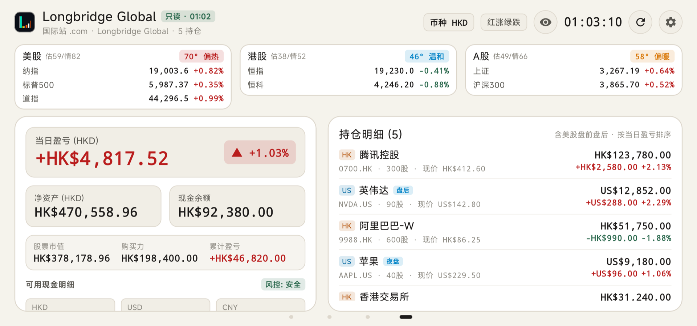
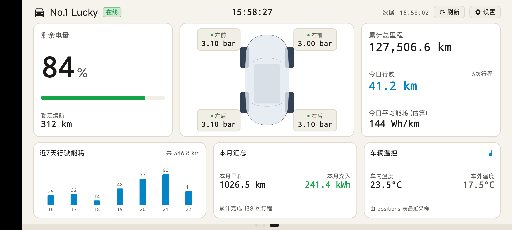
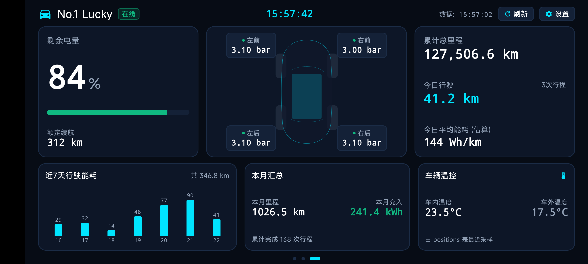
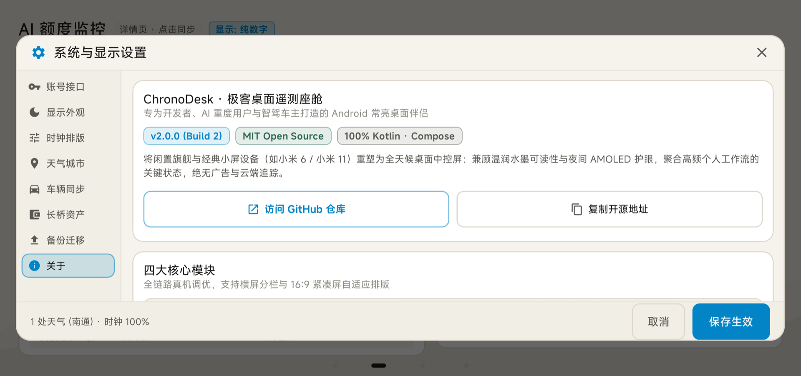
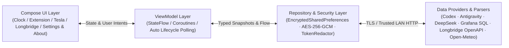

<div align="center">

# ⏱️ ChronoDesk

**极简美学 Android 智能桌面时钟 & 极客全栈遥测座舱**

专为闲置旗舰与经典小屏 Android 设备（小米 11 / 小米 6 等）打造的常亮桌面伴侣

<p>
  <a href="https://github.com/tzwdj01/ChronoDesk/releases/tag/v2.0.1"></a>
  
  
  
  
  <a href="LICENSE"></a>
</p>

<p>
  <a href="#-关于项目-about">关于项目</a> ·
  <a href="#-视觉画廊-showcase">视觉画廊</a> ·
  <a href="#-五大核心子系统">核心功能</a> ·
  <a href="#-系统架构与安全设计">架构与安全</a> ·
  <a href="#-快速安装与构建">下载与构建</a>
</p>



</div>

---

## 💡 关于项目 (About)

大多数人的抽屉里都躺着一台屏幕素质依然出色的旧手机——它们性能充沛，却缺少一个真正配得上桌面立式支架的常亮形态。

**ChronoDesk** 将这方寸屏幕重塑为一站式**桌面时间美学与个人核心工作流遥测中控**：在保留独立机械翻牌时钟的仪式感之余，无感聚合开发者每日高频关注的关键状态——**ChatGPT / Google Antigravity / DeepSeek 算力额度**、**TeslaMate 爱车能耗与停靠位置**、**长桥证券环球市场指数与当日盈亏**以及**多地区实时气象**，全程本地直连、硬件加密，绝无广告与云端中转。

<table>
  <tr>
    <td width="33%" valign="top">
      <strong>🎨 三态视觉一键循环</strong><br/>
      默认 <b>日间彩色</b>（纸感浅底 + 品牌原彩图标）、<b>全水墨</b>（严格 <code>R=G=B</code> 黑白灰）与 <b>夜间深色</b>（AMOLED 纯黑护眼）一键循环，轻触显隐控制栏 <b>0 像素位移</b>。
    </td>
    <td width="33%" valign="top">
      <strong>📐 双屏比例真机调优</strong><br/>
      针对全面屏高分旗舰（如 <b>小米 11</b>）与经典 16:9 紧凑小屏（如 <b>小米 6</b> <code>640×360dp</code>）分别精调留白、列宽权重与触控热区，久置工位不裁切、不折行。
    </td>
    <td width="33%" valign="top">
      <strong>🔐 零中转硬件级安全</strong><br/>
      所有 Token / API Key 统一由 <code>Android KeyStore (AES-256-GCM)</code> 密文托管；<code>TokenRedactor</code> 全链路脱敏，直连官方开放接口或个人私有网关。
    </td>
  </tr>
</table>

---

## 📸 视觉画廊 (Showcase)

> 以下画面均来自 **小米 11** 与 **小米 6** 真机实拍截屏；展示所使用的账户名称、资产与位置数据均已替换为脱敏演示数据集。

### 1. 主视窗三态美学对比 · 轻触零跳变 (Page 0)

左侧高对比机械翻牌时钟集成公历、星期、传统农历、多城气象胶囊与 Tesla / 长桥高频状态胶囊（位置上下边框完全对齐）；右侧同构三平台 AI 额度看板支持**纯数字网格 / 进度条**双形态切换与自由排序。

| 日间彩色模式 · Day Color *(默认)* | 日间全水墨模式 · Pure E-Ink (`R=G=B`) |
| :---: | :---: |
|  |  |

| 夜间 AMOLED 模式 · Cyber Night | 经典 16:9 小屏适配 · Xiaomi 6 实机 |
| :---: | :---: |
|  |  |

---

### 2. 长桥环球资产指数 & AI 额度深度大屏 (Page 1 & Page 3)

左右滑屏即刻切换全屏细分座舱：AI 详情页支持单账号双窗精确倒计时；长桥看板实时聚合**美股 / 港股 / A 股核心指数与市场温度计**、多币种汇率折算（`HKD / USD / CNY`）、红涨绿跌 / 绿涨红跌一键切换与隐私脱敏遮罩。

| AI 算力额度详情大屏 (Extension Page) | 长桥证券资产与美港A市场温度 (Longbridge Portfolio) |
| :---: | :---: |
|  |  |

---

### 3. TeslaMate 智驾座舱日夜双视图 & 设置关于中心 (Page 2 & Settings)

直连自建 Grafana PostgreSQL 数据源执行**纯只读 SQL 采集**，严禁控制指令与车辆唤醒；支持车漆颜色匹配、超清数字车展 / 实车照片与四轮胎压视图一键切换、今日能耗统计、7 日里程柱状图、GCJ-02 国内纠偏离线地图弹窗，以及统一归口管理全部数据源与版本信息的**「关于项目」**面板。

| TeslaMate 日间高清座舱 | TeslaMate 夜间赛博座舱 |
| :---: | :---: |
|  |  |

<p align="center">
  
</p>

---

## ✨ 五大核心子系统

### 1. 🕒 拟物机械翻牌时钟与三态视觉系统
- **分体翻牌与手势微调**：高对比机械中缝折页设计，支持双指捏合缩放（`80% - 150%`）与自由拖拽定位；「复位」按钮整合进顶部默认隐藏的悬浮 `ClockTopBar`，轻触呼出或 6 秒自动隐去时**时钟位置 0 像素跳变**。
- **公历与纯算法农历**：精确计算并展示公历、星期与农历月日；支持 12/24 小时制、可选秒钟位，以及按充电状态 / 时段智能触发的常亮（`FLAG_KEEP_SCREEN_ON`）与防 AMOLED 烧屏每 3 分钟平滑像素微移。
- **三态主题一键循环**：顶栏按钮一键切换 **日间彩色（原彩图标）→ 全水墨（逐像素纯黑白灰）→ 夜间深色（纯黑防反光 + 自动压暗窗亮度）**。

### 2. 🤖 全栈多模型 AI 额度聚合中枢
| 平台 / 数据源 | 监测维度 | 特色能力 |
| :--- | :--- | :--- |
| **ChatGPT (OpenAI)** | `5h` 限额窗口 + `7d` 周额度窗口 | 适配 WHAM 遥测接口，展示具体重置时刻 / 倒计时及剩余重置次数，支持多账号主屏置顶与别名 |
| **Google Antigravity** | **Gemini** 与 **Claude/GPT (3P)** 双轨双窗 | 与 ChatGPT 同构分轨呈现 `5h + 周额度` 实时配额、套餐档位徽标（如 `AI Ultra 20x`）与同步状态 |
| **DeepSeek API** | 账户可用余额 (`CNY` / `USD`) | 直连官方余额接口，过滤冗杂充赠明细，多账号双列紧致排列 |
- 全局支持 **「纯数字看板」** 与 **「进度条看板」** 切换、卡片紧密度调节、右侧分栏比例（`28% - 52%`）以及三平台卡片**任意自定义排序**。

### 3. 📈 长桥证券 (Longbridge OpenAPI) 环球资产与市场温度
- **首页迷你盈亏胶囊**：在主屏 Tesla 胶囊旁并列对齐显示，仅呈现长桥官方图标与**当日盈亏金额 / 涨跌幅百分比**（红涨绿跌 / 绿涨红跌可切换），支持单点独立手动刷新。
- **全屏资产与指数座舱**：
  - 汇总净资产、现金余额、证券市值、购买力、累计盈亏与多币种可用现金明细；
  - 实时行情覆盖 **美股（纳指 / 标普500 / 道指）**、**港股（恒指 / 恒科）**、**A 股（上证 / 沪深300）** 及各市场估值/情绪温度计；
  - 持仓明细支持美股盘前盘后/夜盘标签，一键隐藏金额隐私模式（`••••••`）。

### 4. 🚗 TeslaMate 零唤醒智驾与能耗座舱
- **静默只读护电池**：通过 Grafana DataSource Proxy 查询 PostgreSQL 时序表，仅在 App 前台且必要时按自适应频率轮询，绝不向 Tesla 车控服务器发送唤醒请求。
- **车型识别与实车画廊**：自动识别 `Model 3 / Model Y / Model S / Model X` 与原厂车漆代码并渲染多配色高清数字车模，支持录入本地爱车实拍照片与一键切换四轮 TPMS 胎压环绕图（bar）。
- **行程回溯与高德/国内纠偏定位**：展示最近一次完整行程（起终点围栏/多级地名反解析、时长、距离与百公里电耗 `Wh/km`）、近 7 天里程趋势与月度充放电统计，内置 WGS-84 → GCJ-02 纠偏离线瓦片地图预览。

### 5. 🌦️ 多地区气象胶囊与无凭据配置迁移
- 基于 Open-Meteo 开放接口与内建中国县市地名库 (`ChinaCityDatabase`)，支持 GPS 定位、国内外模糊搜城、多城同卡并列展示（温度、体感、天气图标、湿度、风速）。
- 支持将外观、排版、排序、城市等通用偏好导出为 **Schema v1 纯净 JSON**（严格排除一切 API Key、Token 与邮箱），跨机秒级恢复桌面布局。

---

## 🛠️ 系统架构与安全设计

ChronoDesk 采用 **Clean Architecture + MVVM + 单向数据流（UDF）** 分层解耦，全界面使用 **100% Kotlin + Jetpack Compose (Material 3)** 编写：



### 安全边界设计
- **硬件主密钥密文持久化**：OpenAI OAuth 凭据、Google Antigravity Refresh Token、DeepSeek API Key、Grafana Service Account Token、Longbridge AppKey / Secret / AccessToken 均通过 `Android KeyStore` 派生的 `MasterKey` 写入 `EncryptedSharedPreferences`。
- **重定向与日志防火墙**：[`AuthLoggingInterceptor`](app/src/main/java/com/chronodesk/app/data/network/AuthLoggingInterceptor.kt) 与 [`TokenRedactor`](app/src/main/java/com/chronodesk/app/data/security/TokenRedactor.kt) 强制抹除请求头与调试日志中的敏感字符；[`NetworkClient`](app/src/main/java/com/chronodesk/app/data/network/NetworkClient.kt) 严禁向跨主机重定向携带鉴权头，仅对用户显式信任的私有内网网段开放可配置 HTTP 通信。

<details>
<summary>📂 展开查看完整源码目录结构 (app/src/main/java/com/chronodesk/app)</summary>

```text
app/src/main/java/com/chronodesk/app/
├── ChronoDeskApp.kt                        # 全局 Application 初始化
├── MainActivity.kt                         # 沉浸式全屏、常亮控制、充电/亮度动态响应
├── data/
│   ├── model/                              # 核心不可变数据模型 (ClockSettings, Codex*, Longbridge*, Tesla*, WeatherInfo)
│   ├── network/                            # OkHttp/Retrofit 客户端、Grafana 列式帧解析、天气与气象回退链路
│   ├── provider/                           # OpenAI/Antigravity/DeepSeek 额度采集、Longbridge、TeslaMate SQL、多级位置反解析
│   ├── repository/                         # 仓储存取、缓存水化、Schema v1 导入导出与状态机协调
│   ├── security/                           # CredentialStorage (KeyStore AES-256-GCM)、JwtUtils、TokenRedactor
│   └── utils/                              # LunarCalendarHelper 农历引擎、CoordinateConverter (GCJ-02)、车模与实拍管理
└── ui/
    ├── clock/                              # ClockScreen、ClockExtensionPage、FlipDigit、WeatherCard、DualAccountQuotaSection、ModelProviderLogos
    ├── longbridge/                         # LongbridgeScreen (指数/温度/盈亏/持仓) & LongbridgeViewModel
    ├── tesla/                              # TeslaScreen (车模/胎压/行程/趋势)、VehicleLocationMapDialog & TeslaViewModel
    ├── settings/                           # SettingsDialog (8大分组含关于页)、账号 OAuth/Token 授权与配置弹窗
    └── theme/                              # Color.kt (Day Color / Pure Ink R=G=B / AMOLED Night 统一色板系统)、Theme.kt
```

</details>

---

## 📦 快速安装与构建

### 方式一：直接下载预编译安装包 (推荐)
前往 [**GitHub Releases · v2.0.1**](https://github.com/tzwdj01/ChronoDesk/releases/tag/v2.0.1) 下载：
- `ChronoDesk-v2.0.1-release.apk` — 正式发布签名版（包名 `com.chronodesk.app`，移除调试钩子、体积更轻量）
- `ChronoDesk-v2.0.1-debug.apk` — 开发调试版（包名 `com.chronodesk.app.debug`，支持 ADB 调试与视图检查，可与正式版共存）
- `SHA256SUMS.txt` — 所有 APK 安装包的 SHA-256 完整性校验摘要

```bash
# 通过 ADB 安装正式版
adb install -r ChronoDesk-v2.0.1-release.apk

# 验证签名与完整性
apksigner verify --print-certs ChronoDesk-v2.0.1-release.apk
shasum -a 256 -c SHA256SUMS.txt
```

### 方式二：从源码编译与运行测试
环境要求：**OpenJDK 17 LTS** · **Android SDK 34** · **Gradle 8.7**

```bash
# 1. 运行全量 134 项单元测试与 Android Lint 静态分析
./gradlew testDebugUnitTest lintDebug

# 2. 构建 Debug APK
./gradlew assembleDebug

# 3. 构建正式签名 Release APK（支持从环境变量注入签名密钥）
KEYSTORE_PATH=/path/to/release.jks \
KEYSTORE_PASSWORD=*** \
KEY_ALIAS=*** \
KEY_PASSWORD=*** \
./gradlew assembleRelease
```

---

## 📄 开源许可证 (License)

本项目基于 [**MIT License**](LICENSE) 开源。
其中多模型额度模型与客户端适配部分设计借鉴了 [CC Switch](https://github.com/farion1231/cc-switch) 的优秀思路（Copyright (c) 2025 Jason Young）。

<div align="center">
  <br/>
  <sub>如果 ChronoDesk 让你的桌面设备焕发了第二春，欢迎点亮右上角 <b>★ Star</b> 支持项目持续进化！</sub>
</div>
