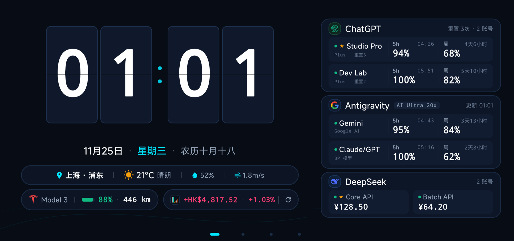

# ChronoDesk - 极简科技风 Android 智能桌面时钟 & 极客监控仪表盘

<p align="center">
  
</p>

<p align="center">
  
  
  
  
  
  
</p>

一款专为开发者与极客打造的 **Android 原生智能桌面时钟与设备监控仪表盘**。专为将闲置手机（如小米 6、小米 11 等）改造为桌面常亮伴侣而生。

集成了精致的拟物机械翻牌时钟、公历农历天气气象胶囊、**水墨日间 / 深色 AMOLED 双主题**、**ChatGPT / DeepSeek / Gemini API 多模型订阅额度聚合看板**，以及深度集成的 **TeslaMate 车辆能耗与状态大屏**。

---

## 📸 真实界面展示 (Showcase)

> 全部截图均来自 Android 真机实测运行（真实接口数据驱动）。
> 注：演示截图中所展示的账户别名、额度及车辆数据均为测试环境演示数据或已全面脱敏处理，非真实个人隐私数据。

### 1. 主页面：机械翻牌时钟 & AI 额度聚合监控 (Page 0)
横屏三栏黄金比例布局。左侧为大尺寸翻牌数字时钟、公历农历与多地区天气气象胶囊；右侧紧凑呈现 ChatGPT Plus 5小时/周额度双窗口与 DeepSeek 账户余额。

| 水墨纸感模式 (Ink Day) | 赛博科技模式 (AMOLED Night) |
| :---: | :---: |
|  |  |

---

### 2. Tesla 专属页面：TeslaMate 车辆能耗仪表盘 (Page 2)
直连自建 TeslaMate PostgreSQL 数据源。中间自绘纯代码 Canvas 车模轮廓并标注四轮胎压（bar），左右呈现电量 SOC、续航里程、今日行程里程与能耗估算、7 日能耗柱状图、月度汇总及车内外温控。

| 深色科技模式 (AMOLED Night) | 水墨纸感模式 (Ink Day) |
| :---: | :---: |
|  |  |

---

### 3. 扩展遥测页与经典老机型实测 (Page 1 & Xiaomi 6)
支持左右横向滑屏自由穿梭，第二页展示各模型 API 的 Token 用量深度遥测与往返延时；同时原生深度适配 16:9 紧凑型经典机型（如小米 6），自适应字体与卡片间距，不遮挡、不截断，让闲置设备焕发桌面新生。

| AI 接口延迟与 Token 遥测扩展页 (Page 1) | 小米 6 (16:9 紧凑屏实测运行) |
| :---: | :---: |
|  |  |

---

## ✨ 核心特性矩阵

### 🕒 1. 拟物机械翻牌时钟与历法
- **分体机械折叠翻牌动画 (Split-Flap Animation)**：
  - 细腻的高清机械折页中缝阴影与高光细节，时、分数字大号居中，支持秒钟独立悬浮切换。
- **公历、星期与传统农历**：
  - 完整呈现公历日期与星期；内置纯算法农历转换引擎，精准呈现农历月日（如 `农历十月十五`）。
- **时钟尺寸与位置调节**：
  - 支持双指手势或设置滑块自由调节时钟大小比例（80% - 150%），支持上下左右自由平移并一键复位居中。
- **AMOLED 防烧屏与常亮**：
  - 原生保持屏幕常亮（`FLAG_KEEP_SCREEN_ON`）；内置防烧屏微移算法（Burn-in Shift），每隔 3 分钟平滑微调像素位置，守护屏幕寿命。

### 🤖 2. 多模型 AI 额度聚合看板
- **ChatGPT (Codex) 官方遥测**：
  - 深度适配 OpenAI WHAM 额度监控接口，精准区分并同时展示 **5 小时限额窗口** 与 **7 天周额度窗口**；
  - 实时显示重置倒计时（如 `14:24 重置`）与剩余额度重置次数（如 `重置:3次`）。
- **DeepSeek 官方 API**：
  - 直连 DeepSeek 官方开放接口，实时呈现账户可用余额（如 `¥92.59 CNY`），去除充值充赠冗余信息，清爽明了。
- **Gemini API 连接状态**：
  - 直连 Google Generative Language 官方模型列表接口，真实反映 Key 有效性与模型就绪连接状态，杜绝虚构配额。
- **多账号选择与状态胶囊**：
  - 支持在设置中自由勾选展示/隐藏特定账号，支持根据重要程度排序；
  - 额度耗尽（Exhausted）、即将耗尽（Warning）与正常（Normal）动态变色预警。

### 🌦️ 3. 多地区天气气象胶囊
- **多城市多行并列**：支持同时添加并并列展示多个关注地区的天气气象（如 `南通`、`北京`、`深圳` 等）。
- **实时指标**：气温、天气状况图标与文字、空气湿度百分比、实时风速。
- **零商业 Key 依赖**：基于 Open-Meteo 开放气象数据源，支持 GPS 自动定位与城市快捷列表切换。

### 🚗 4. TeslaMate 车辆监控模块 (New!)
- **纯代码自绘车模 Canvas**：
  - 几何俯视车身轮廓自适应绘制（不使用任何未授权商标图片），四周清晰标注 **左前、右前、左后、右后 4 轮胎压（bar）**，胎压异常智能色卡提醒。
- **全维度车辆数据看板**：
  - **核心指标**：剩余电量 SOC 百分比、电量进度条、额定续航（km）、累计总里程（km）。
  - **今日行程**：今日行驶距离、已完成行程次数、今日平均能耗估算（Wh/km）。
  - **能耗与趋势**：近 7 天每日行驶能耗柱状图可视化展示、本月累计行驶与充入电量统计。
  - **双温控**：车内温度与车外环境温度最近采样对比。
- **安全与电池保护原则**：
  - **只读采集**：直连本地 Grafana PostgreSQL 接口执行只读 SELECT 查询，严禁任何控制指令，**绝不唤醒车辆**。
  - **自适应动态轮询**：车辆行驶或充电中 30s 刷新，日常在线 60s 刷新，休眠状态 180s 刷新，节约服务器资源。
  - **内网安全通信**：支持配置可信局域网明文 HTTP 传输，解决 Android 9+ 系统级明文流量拦截。
  - **一键级联发现**：自动探测 PostgreSQL 数据源 UID 与已绑定车辆，一键点击连接测试。

### 🌓 5. 水墨纸感 / 赛博夜间双主题
- **水墨纸感日间模式 (Ink Paper Day)**：米白柔和底色配合温润纸质纹理，高对比度墨黑数字，适合日间书房与办公室，视觉温和不刺眼。
- **深色科技夜间模式 (AMOLED Cyber Night)**：纯黑背景（RGB #000000），荧光青科技线条点缀，深度降低夜间卧室反光，极致省电。
- **0 像素位移**：日间与夜间模式切换时，所有组件坐标、字体排版严格保持 0 像素位移。

### 📲 6. 跨设备免云端安全迁移
- 针对多台闲置手机同时使用的场景，提供基于本地安全广播的跨设备数据迁移功能；
- 账号凭据与个性化配置通过局域网直接传输，**数据不经过任何第三方云端服务器**，杜绝隐私泄漏。

---

## 🔒 安全与凭据保护架构

- **硬件级密文存储**：敏感凭据（OpenAI Access Token、Refresh Token、DeepSeek API Key、Grafana Service Account Token）统一使用 `Android KeyStore` 生成主密钥，通过 `EncryptedSharedPreferences`（AES-256-GCM）密文持久化。
- **日志自动脱敏 (Token Redaction)**：所有网络日志、JSON 序列化与 Retrofit 请求头均经过 `TokenRedactor` 处理，敏感字符一律打码掩蔽。
- **严格重定向隔离**：网络拦截器内置跨主机重定向防护，严禁向第三方未经验证的域名传递 Authorization 凭据。

---

## 🛠️ 技术架构

- **开发语言**: 100% Kotlin
- **界面开发**: Jetpack Compose + Material 3 (全声明式 UI 与动态手势交互)
- **架构模式**: Clean Architecture + MVVM + UDF (单向数据流)
- **并发与响应式**: Kotlin Coroutines + StateFlow / SharedFlow
- **网络与解析**: Retrofit 2 + OkHttp 3 + Gson + DataFrame 列式解析引擎
- **本地存储**: Android KeyStore + EncryptedSharedPreferences + SharedPreferences

```
app/src/main/java/com/chronodesk/app/
├── MainActivity.kt                 # 入口 Activity、全屏沉浸、屏幕常亮与夜间亮度控制
├── ChronoDeskApp.kt                # Application 单例初始化
├── data/
│   ├── model/                      # 数据模型 (CodexAccount, TeslaSnapshot, WeatherInfo...)
│   ├── network/                    # Retrofit 接口、GrafanaApi、OkHttp 拦截器与列式解析器
│   ├── provider/                   # 数据源提供器 (RealCodexUsageProvider, TeslaDataProvider)
│   ├── repository/                 # 数据仓储层 (AccountRepo, TeslaRepo, WeatherRepo, SettingsRepo)
│   └── security/                   # 安全模块 (CredentialStorage KeyStore加密, TokenRedactor)
└── ui/
    ├── clock/                      # 翻牌时钟、天气胶囊、AI额度卡片、横向滑屏系统
    ├── tesla/                      # TeslaScreen、Canvas车身胎压俯视图、TeslaViewModel
    ├── settings/                   # 系统设置弹窗、账号管理、设备授权、TeslaMate配置弹窗
    └── theme/                      # 水墨日间与深色AMOLED双主题配色系统
```

---

## 📦 构建与部署

### 开发环境要求
- OpenJDK 17 LTS
- Android SDK 34 (Android 14)
- Gradle 8.7

### 1. 运行自动化单元测试
```bash
./gradlew testDebugUnitTest
```
> 目前包含 **74 项单元测试**，全面覆盖 AI 额度状态机、窗口百分比截断、Token 脱敏与安全日志、加密凭据隔离、常亮与夜间生命周期、Tesla 能耗与网络安全配置等关键路径，全部通过。

### 2. 构建 Release / Debug APK
```bash
# 构建 Debug 版本 (包含内网 HTTP 联调白名单与测试辅助配置)
./gradlew assembleDebug

# 构建 Release 正式发布包 (严格仅允许 HTTPS，支持从环境变量注入正式签名)
./gradlew assembleRelease
```
产物位置：
- Debug: `app/build/outputs/apk/debug/app-debug.apk`
- Release: `app/build/outputs/apk/release/app-release.apk`

### 3. 安装与运行
```bash
adb install -r app/build/outputs/apk/debug/app-debug.apk
adb shell am start -n com.chronodesk.app.debug/com.chronodesk.app.MainActivity
```

### 4. 安装与版本升级指引

#### 安装与签名冲突排查
- **标准安装**:
  使用 `adb install -r <apk-file>` 进行安装。
- **覆盖安装签名冲突解决**:
  若安装提示 `INSTALL_FAILED_UPDATE_INCOMPATIBLE`，说明设备上已安装不同签名证书的构建。请先卸载旧版本再安装：
  ```bash
  adb uninstall com.chronodesk.app.debug   # 针对 Debug 构建
  # 或
  adb uninstall com.chronodesk.app         # 针对 Release 正式包
  adb install app-release.apk
  ```
- **降级限制**: Android 系统默认限制应用版本号降级（不可直接覆盖低于当前已装 versionCode 的安装包）。

#### 数据保留与重新授权指引
- **通用设置保留范围**:
  基础桌面配置（时间制式、秒钟开关、常亮策略、主题模式、时钟缩放与位置、天气城市等）在升级过程中完全保留。支持在设置界面通过系统文件选择器导出/导入带 `schemaVersion: 1` 的 JSON 配置文件。
- **安全升级与重新授权**:
  新版本已废止所有明文凭据存储通道并自动清理旧迁移缓存。若升级后账号卡片提示「授权已失效」或「待同步」，请按如下指引重新绑定：
  1. **ChatGPT (Codex)**: 点击卡片或顶栏「账号管理」，点击「重新授权」重新完成 OAuth 认证；
  2. **DeepSeek / Gemini API**: 点击顶栏「账号管理」，重新填入或校验有效 API Key；
  3. **Tesla 车辆监控**: 若 Grafana Service Account Token 发生变动，进入「设置 -> TeslaMate 配置」更新 Token 并保存测试。

---

## 📄 开源许可证

本项目基于 [MIT License](LICENSE) 开源。
涉及 CC Switch 代码设计与逻辑部分，版权归属原作者 (Copyright (c) 2025 Jason Young)。
