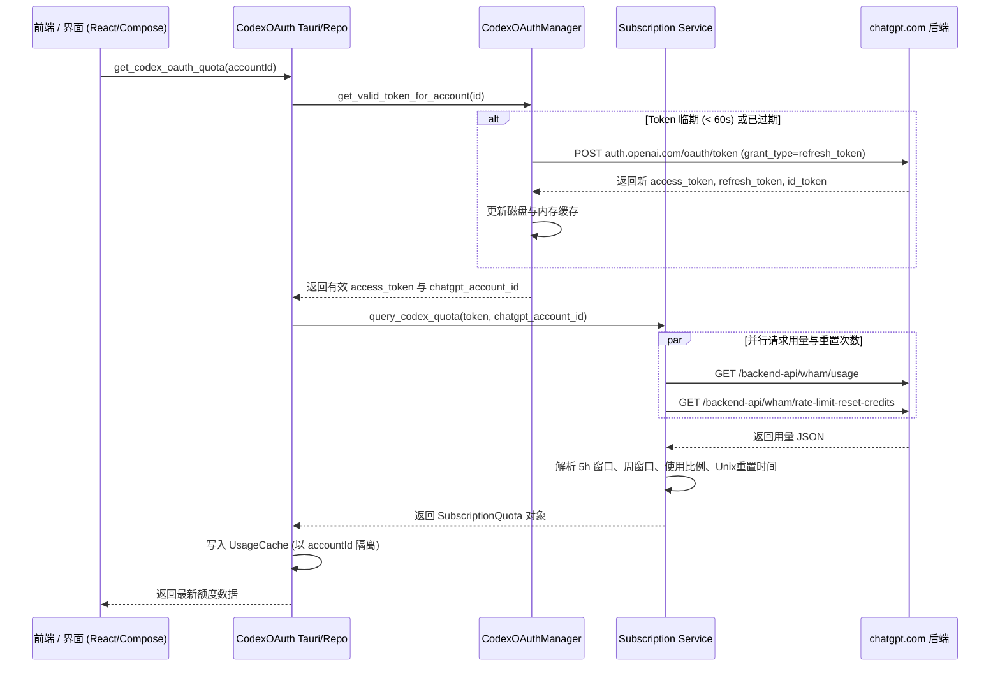

# CC Switch (Codex OAuth & 额度监控) 深度研究与 Android 适配技术报告

## 一、参考项目与版本

- **参考开源仓库**: [https://github.com/farion1231/cc-switch](https://github.com/farion1231/cc-switch)
- **分析分支**: `main`
- **具体 Commit SHA**: `b044f4b03190b8208e7e592d326609e7f2fbe097` (2026-11-18)
- **开源许可证**: MIT License (Copyright (c) 2025 Jason Young)

---

## 二、涉及核心文件路径与职责

| 文件路径 | 语言/技术 | 核心职责 |
|---|---|---|
| `src-tauri/src/commands/codex_oauth.rs` | Rust (Tauri Command) | 供前端调用的 Codex OAuth 订阅额度查询及模型列表命令，管理账号解析与托盘写穿缓存 |
| `src-tauri/src/proxy/providers/codex_oauth_auth.rs` | Rust | Codex OAuth 管理器核心：设备码流程 (Device Code)、Token 存储与刷新、JWT 解析、多账号隔离锁 |
| `src-tauri/src/proxy/providers/codex_oauth_auth/browser.rs` | Rust (Axum) | 桌面端本地 1455 端口的回调服务，实现标准 PKCE 浏览器授权码登录 |
| `src-tauri/src/services/subscription.rs` | Rust (Reqwest) | 调用 ChatGPT 后端 `wham/usage` 与 `wham/rate-limit-reset-credits` 接口，解析限额窗口与重置时间 |
| `src-tauri/src/services/usage_cache.rs` | Rust | 内存中的用量写穿缓存，按账号 ID 隔离，进程内非持久化 |
| `src/components/CodexOauthAccountQuota.tsx` | TypeScript / React | 前端单账号额度渲染组件，呈现用量进度条与最后刷新时间 |
| `src/components/settings/auth/AccountQuota.tsx` | TypeScript / React | 统一的额度卡片 UI 渲染逻辑，计算剩余百分比、倒计时与告警色调 |
| `src/components/settings/auth/RefreshAllQuotaButton.tsx` | TypeScript / React | 授权中心“全部刷新”按钮，防并发重复请求与统一转圈状态 |
| `src/lib/query/subscription.ts` | TypeScript (TanStack Query) | 账号维度的数据缓存键设计（`["codex_oauth", "quota", accountId]`）与自动轮询调度 |
| `src/lib/query/queries.ts` | TypeScript | `resolveDisplayUsage` 与 Keep-Last-Good 策略实现：网络抖动保留上次成功数据 |

---

## 三、关键函数及调用链分析

### 1. 额度查询与刷新调用链



- **关键函数 1: `get_codex_oauth_quota` (`codex_oauth.rs` 第 28 行)**
  解析目标账号 ID，调用 `query_codex_oauth_quota_for`。若成功，写入 `usage_cache.put_codex_oauth(id, quota)`。
- **关键函数 2: `get_valid_token_for_account` (`codex_oauth_auth.rs` 第 791 行)**
  先从只读内存缓存快速读取。若距离过期不足 60 秒（`TOKEN_REFRESH_BUFFER_MS = 60_000`），获取该账号专属细粒度互斥锁（`refresh_locks`），并发起刷新请求。
- **关键函数 3: `query_codex_quota` (`subscription.rs` 第 1050 行)**
  利用 `tokio::join!` 并行请求 `query_codex_usage` 和 `query_codex_reset_credits`。若主请求成功，拼接重置次数后返回。

---

## 四、OAuth 登录流程与协议细节

CC Switch 支持两种授权流程：

### 1. 流程一：Device Code Flow（设备码模式，最适合移动端 Android）
- **客户端标识**: `CODEX_CLIENT_ID = "app_EMoamEEZ73f0CkXaXp7hrann"`（OpenCode 及官方 Codex CLI 相同 Client ID）。
- **步骤 1 (启动)**: POST `https://auth.openai.com/api/accounts/deviceauth/usercode`
  - Body: `{"client_id": "app_EMoamEEZ73f0CkXaXp7hrann"}`
  - 响应: `{ "device_auth_id": "...", "user_code": "ABCD-1234", "interval": 5, "expires_in": 900 }`
- **步骤 2 (用户授权)**: 打开验证页面 `https://auth.openai.com/codex/device`（或带上 `user_code` 参数），用户在浏览器中确认登录。
- **步骤 3 (轮询)**: 每隔 `interval` 秒 POST `https://auth.openai.com/api/accounts/deviceauth/token`
  - Body: `{"device_auth_id": "...", "user_code": "..."}`
  - HTTP 403 / 404: 用户未完成授权，继续等待。
  - HTTP 200: 返回 `{ "authorization_code": "...", "code_verifier": "..." }`。
- **步骤 4 (换取 Token)**: POST `https://auth.openai.com/oauth/token`
  - 格式: `application/x-www-form-urlencoded`
  - 参数:
    - `grant_type`: `"authorization_code"`
    - `code`: 上一步获取的 authorization_code
    - `redirect_uri`: `"https://auth.openai.com/deviceauth/callback"`
    - `client_id`: `"app_EMoamEEZ73f0CkXaXp7hrann"`
    - `code_verifier`: 上一步获取的 code_verifier
  - 响应: `{ "access_token": "...", "refresh_token": "...", "id_token": "...", "expires_in": 3600 }`

### 2. 流程二：Browser PKCE Flow（本地 Loopback 回调模式）
- 本地起 HTTP 监听器 `http://localhost:1455/auth/callback`。
- 生成 SHA256 PKCE `code_verifier` 和 `code_challenge`。
- 启动浏览器打开 `https://auth.openai.com/oauth/authorize?...`。
- 回调拦截后向 `https://auth.openai.com/oauth/token` 换取 Token。
- *在 Android 平台上限制*: Android 原生应用无法像桌面端随意绑定固定本地端口且保持后台存活，容易遇到端口冲突或后台冻结。

---

## 五、Token 存储、刷新与安全机制

1. **持久化与数据结构**:
   - CC Switch 桌面端将数据持久化在 `codex_oauth_auth.json` 中：
     ```json
     {
       "version": 2,
       "accounts": {
         "<account_id>": {
           "account_id": "uuid-...",
           "chatgpt_account_id": "org-...",
           "email": "user@example.com",
           "refresh_token": "...",
           "authenticated_at": 1740000000,
           "id_token": "eyJ...",
           "token_updated_at_ms": 1740000000000
         }
       },
       "default_account_id": "<account_id>"
     }
     ```
   - 内存只缓存短效的 `access_token`，不写入明文磁盘。
2. **Token 刷新流程**:
   - POST `https://auth.openai.com/oauth/token`
   - Form 数据:
     - `grant_type`: `"refresh_token"`
     - `refresh_token`: `<refresh_token>`
     - `client_id`: `"app_EMoamEEZ73f0CkXaXp7hrann"`
     - `scope`: `"openid profile email"`
3. **错误分类机制 (`refresh_rejection_is_permanent`)**:
   - **永久性失败**: HTTP 401，或返回错误码 `invalid_grant`、`refresh_token_expired`、`refresh_token_reused`、`refresh_token_invalidated`。此时标记该账号为 `Expired`，不再无休止重试。
   - **瞬时网络失败**: HTTP 429、5xx、网络连接超时、DNS 异常等。此时不判定凭据失效，抛出 Transient Error 并保留内存与界面的最后成功用量快照。

---

## 六、Codex 额度获取协议与响应结构

### 1. 实际请求协议
- **请求端点**: `GET https://chatgpt.com/backend-api/wham/usage`
- **请求头**:
  - `Authorization: Bearer <access_token>`
  - `User-Agent: codex-cli`
  - `Accept: application/json`
  - `ChatGPT-Account-Id: <chatgpt_account_id>` (若存在)
- **附带重置次数端点**: `GET https://chatgpt.com/backend-api/wham/rate-limit-reset-credits`
  - 请求头附带: `OpenAI-Beta: codex-1`

### 2. 接口性质与合规/兼容性风险说明
> [!WARNING]
> **接口性质提示**：
> `https://chatgpt.com/backend-api/wham/usage` 是 OpenAI 为 Codex CLI / ChatGPT 客户端提供的内部后端接口，**并非** OpenAI 官方具有公开文档和 SLA 保证的开放平台第三方标准 REST API。
> 1. 上游随时可能修改接口路径、字段名称或校验规则。
> 2. 该接口可能受到 Cloudflare / CDN 风险控制和频率限制（HTTP 403 / 429）。
> 3. Android 原生端在接入时，必须设计健壮的容错机制（字段可选、数据模型容错、Mock 降级机制）。

### 3. JSON 响应字段映射

```json
{
  "rate_limit": {
    "primary_window": {
      "used_percent": 18.5,
      "limit_window_seconds": 18000,
      "reset_at": 1740012345
    },
    "secondary_window": {
      "used_percent": 42.0,
      "limit_window_seconds": 604800,
      "reset_at": 1740500000
    }
  },
  "credits": {
    "has_credits": false,
    "unlimited": false,
    "balance": "0"
  },
  "plan_type": "plus"
}
```

- **5 小时额度 (`primary_window`)**:
  - `limit_window_seconds = 18000` (5 * 3600 秒)
  - `used_percent`: 已用百分比（0.0 ~ 100.0）
  - **剩余百分比计算**: `remaining_percent = (100.0 - used_percent).coerceIn(0.0, 100.0)`
  - `reset_at`: Unix 秒级时间戳。注意：若 `used_percent == 0.0`，上游可能返回虚假的当前时间+窗口时长，CC Switch 特意将此时的重置时间置为空，以防产生虚假倒计时。
- **周额度 (`secondary_window`)**:
  - `limit_window_seconds = 604800` (7 * 24 * 3600 秒)
  - `used_percent`: 周用量已用百分比
- **套餐显示 (`plan_type`)**:
  - `plus` -> "Plus", `pro` -> "Pro 200", `free` -> "Free", `business` -> "Business", `team` -> "Business" 等。

---

## 七、多账号隔离与用量缓存机制

1. **多账号主键隔离**:
   - 每个账号分配一个本地唯一的 `account_id`（UUID 字符串）。
   - 凭据存储使用 `HashMap<account_id, Credential>`，不共用任何全局单例 Token。
2. **缓存键设计**:
   - 前端 TanStack Query 键: `["codex_oauth", "quota", accountId]`。
   - 内存托盘缓存: `HashMap<accountId, SubscriptionQuota>`。
   - 切换或刷新单账号时，仅以自身的 `accountId` 检索与更新，绝不发生数据串号。
3. **Keep-Last-Good 降级策略**:
   - 当遇到网络错误、超时或 5xx 时，前端查询进入 reject 状态，但 UI 不会显示全空白或崩溃，而是取出 `lastGoodSnapshot` 渲染，并展示“网络重试中 / 同步失败，显示上次成功数据”。
   - 只有当凭据明确过期（401 / Invalid Grant）时，才主动废弃旧快照并呈现“登录已失效，请重新登录”。

---

## 八、两套使用量统计的本质区别

在 CC Switch 代码库中严格区分了两种用量概念，本项目**只需第一种**：
1. **Codex OAuth 订阅额度 (Subscription Quota)**：
   - 针对 ChatGPT Plus / Pro 订阅的官方周期使用限制（5 小时窗口、7 天窗口）。
   - 来源：`https://chatgpt.com/backend-api/wham/usage`。
   - 单位：百分比（%）及重置时刻。
2. **会话日志 / 代理 Token 统计 (Usage Statistics / JSONL Logs)**：
   - 本地代理服务器截获请求后记录的输入/输出 Token 数量、费用计算（USD）及 JSONL 审计日志。
   - 来源：`src-tauri/src/proxy/usage/` 中的计算器与日志解析器。
   - **本项目不采用此统计，坚决避免混淆**。

---

## 九、Android 平台适配难点与技术方案

1. **凭据安全存储**:
   - 桌面端直接写入 json 存在明文风险。
   - **Android 适配**: 采用 Android 官方推荐的 `EncryptedSharedPreferences` / `Android Keystore` 进行硬件级 AES-256-GCM 加密存储，保证 `refresh_token` 和敏感凭据无法被普通文件读取或调试导出。
2. **OAuth 授权体验**:
   - 桌面端采用 Localhost HTTP 监听器（1455 端口）。在 Android 上，端口常驻容易被系统休眠杀死且容易被第三方应用劫持。
   - **Android 适配**:
     - 方案 A（优先）：**Device Code Flow**。App 获取 `user_code` 后，通过 Chrome Custom Tabs 打开 `https://auth.openai.com/codex/device`，后台轮询换取 Token。流程极度稳定，无须深层链接回调，无须绑定系统端口。
     - 方案 B（安全降级）：**Manual Token Import / Direct Input**。允许用户在受信任的环境下直接粘贴已有的 Token，作为极客用户的无浏览器备用手段。
     - 方案 C（测试与演示）：**Mock Usage Provider**，内置符合真实后端结构的用量模拟器，以便在无真实 ChatGPT 账号或断网离线时完成自动化测试和 UI 交互。
3. **后台保活与电量控制**:
   - Android 对后台轮询有严格的 Doze 限制。桌面时钟通常在前台全屏运行（保持屏幕常亮）。
   - 在时钟处于前台可见状态时，启动协程定时器按用户配置（5/10/15/30/60 分钟）进行自动刷新；退到后台时自动挂起轮询，节省电量。

---

## 十、验证结论汇总

| 验证项 | 源码确认状态 | 真实环境验证要求 |
|---|---|---|
| Device Code API 路径与请求结构 | ✅ 源码已完全确认 | 上游 API 连通性需联网测试 |
| OAuth Token 刷新方式与参数 | ✅ 源码已完全确认 | 真实 Refresh Token 轮换需账号验证 |
| `wham/usage` 请求头与 JSON 字段 | ✅ 源码已完全确认 | 5h/周窗口需真实 Plus/Pro 账号验证 |
| 剩余比例与重置时间换算公式 | ✅ 源码已完全确认 | 本地时区与 UTC 时间转换需单元测试 |
| 凭据多账号物理隔离机制 | ✅ 源码已完全确认 | 双账号并发刷新需并发测试 |
| Keep-Last-Good 降级策略 | ✅ 源码已完全确认 | 断网场景需单元测试覆盖 |

> **声明**：本研究报告所有关于 CC Switch 的调用链、字段和逻辑均直接提取并验证自 Commit `b044f4b03190b8208e7e592d326609e7f2fbe097` 真实源码。
